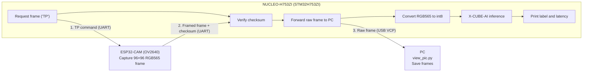

# Edge-Waste-Classifier_ESP32-CAM_STM32_X-CUBE-AI

An end-to-end embedded vision system that captures an image, classifies household waste as **organic**, **paper**, or **plastic** entirely on-device, and streams the raw frame to a PC for logging and inspection.

The model is a MobileNetV2 (α = 0.35, 96×96 input) trained in TensorFlow, quantized to **int8** (~630 KB TFLite), and deployed to an STM32H753ZI microcontroller on the **NUCLEO-H753ZI** board using **ST Edge AI** (X-CUBE-AI) code generation.

## Highlights

- **Fully on-device inference.** No cloud, no network dependency. Classification runs on the STM32 in a few hundred milliseconds.
- **Small, fast, quantized model.** int8 weights and activations, fitting comfortably in MCU memory.
- **Robust to low-cost camera quality.** Training data was augmented with a degradation pipeline that mimics OV2640 optics and sensor noise, so the model generalizes to real camera frames rather than clean web photos.
- **Reliable data link.** Frames are sent over UART with a length header and checksum; corrupted frames are detected and dropped.

## Results

| Metric | Value |
|---|---|
| Overall validation accuracy (int8, degraded inputs) | **89.2%** |
| Organic | 94.2% |
| Paper | 94.3% |
| Plastic | 73.1% |
| Model size (int8 TFLite) | ~630 KB |
| Input | 96 × 96 RGB |

Validation was run on 758 held-out images using the quantized model with the same preprocessing used on the device.

## Demo


https://github.com/user-attachments/assets/cb6f8953-b254-4b68-843e-7fb5ec1bc4bc


## System Architecture



1. The STM32 sends a `TP` command to the ESP32-CAM.
2. The ESP32-CAM captures a fresh RGB565 frame and returns it with a `0xAA 0x55` header, length field, and 32-bit checksum.
3. The STM32 validates the frame, converts RGB565 to the model's int8 input format, and runs inference.
4. The predicted class and inference time are printed over the debug UART. The raw frame is forwarded to the PC.
5. `view_pic.py` reassembles the stream, validates each frame, and saves it as an upscaled JPEG.

## Wiring

The ESP32-CAM and the NUCLEO-H753ZI communicate over UART at 115200 baud. The ESP32-CAM is powered from its own USB supply, so no 5V wire is needed between the boards.

| ESP32-CAM | Signal | NUCLEO-H753ZI | Signal | Notes |
|---|---|---|---|---|
| GPIO15 | TX | USART6 RX (PC7) | RX | Frames and checksums sent to STM32 |
| GPIO14 | RX | USART6 TX (PC6) | TX | `TP` request sent to ESP32-CAM |
| GND | GND | GND | GND | Common ground (required) |

The NUCLEO-H753ZI connects to the PC over its ST-Link USB port, which exposes a virtual COM port (COM6 on our setup):

| NUCLEO-H753ZI | Signal | Connection | Notes |
|---|---|---|---|
| USART3 TX (PD8) | TX | ST-Link VCP | Debug output (`printf`) and frame forwarding to the PC |

The ESP32-CAM camera pins are fixed by the AI Thinker board (see `send_pic.ino`).

## Repository Contents

| File | Description |
|---|---|
| `training/training_notebook.ipynb` | Dataset preparation, augmentation, MobileNetV2 training, int8 quantization, and on-device-compatible validation |
| `esp32cam/send_pic.ino` | ESP32-CAM firmware: camera setup, frame packetization, and UART transmission |
| `stm32/Core/Src/main.c` | STM32 application entry, UART frame request and checksum verification (CubeMX-generated with user sections) |
| `stm32/X-CUBE-AI/App/app_x-cube-ai.c` | Inference wrapper: RGB565 → int8 preprocessing, network execution, and class decoding |
| `pc_receiver/view_pic.py` | PC-side receiver that parses the stream and saves captured frames |

The X-CUBE-AI generated network sources (`network.c`, `network_data.c`) are produced by ST Edge AI from the trained `.tflite` model and are included in `stm32/X-CUBE-AI/App/`.

## Getting Started

### 1. Train and export the model
Open `training/training_notebook.ipynb` in Google Colab, add your Kaggle API key, and run all cells. The notebook downloads the dataset, trains, quantizes, and exports `trash_int8.tflite` plus `model_meta.json`.

### 2. Generate the STM32 network
Import `trash_int8.tflite` into ST Edge AI (X-CUBE-AI) in STM32CubeIDE, select the NUCLEO-H753ZI board (STM32H753ZI) as the target, and generate the C package. Replace the generated files in `stm32/X-CUBE-AI/App/` and keep the `app_x-cube-ai.c` integration.

### 3. Wire the boards
Connect the ESP32-CAM and NUCLEO-H753ZI as shown in the [Wiring](#wiring) table.

### 4. Flash the ESP32-CAM
Upload `esp32cam/send_pic.ino` to an AI Thinker ESP32-CAM.

### 5. Flash the STM32
Open the `stm32/` folder in STM32CubeIDE, build, and flash.

### 6. Capture and view frames on the PC
```bash
pip install pyserial pillow
python pc_receiver/view_pic.py
```
Set `PORT` in `view_pic.py` to your board's virtual COM port. Captured frames are saved to `captures/`.

## Configuration

| Parameter | Location | Purpose |
|---|---|---|
| `BAUD` | `send_pic.ino` | Link speed between ESP32-CAM and STM32 (must match the STM32 UART) |
| `PORT`, `BAUD` | `view_pic.py` | PC serial port and speed |
| `IMG_MAX` | `main.c` | Maximum accepted frame size |

## Future Work

- Expand the dataset with real captures from the target camera and mounting position
- Improve plastic recall, the weakest class (73.1%), through targeted data collection
- Add a live confidence threshold and an "unknown" class for out-of-distribution items

## Acknowledgements

- Dataset: [Garbage Classification](https://www.kaggle.com/datasets/mostafaabla/garbage-classification) (Kaggle)
- Model deployment: ST Edge AI / X-CUBE-AI
